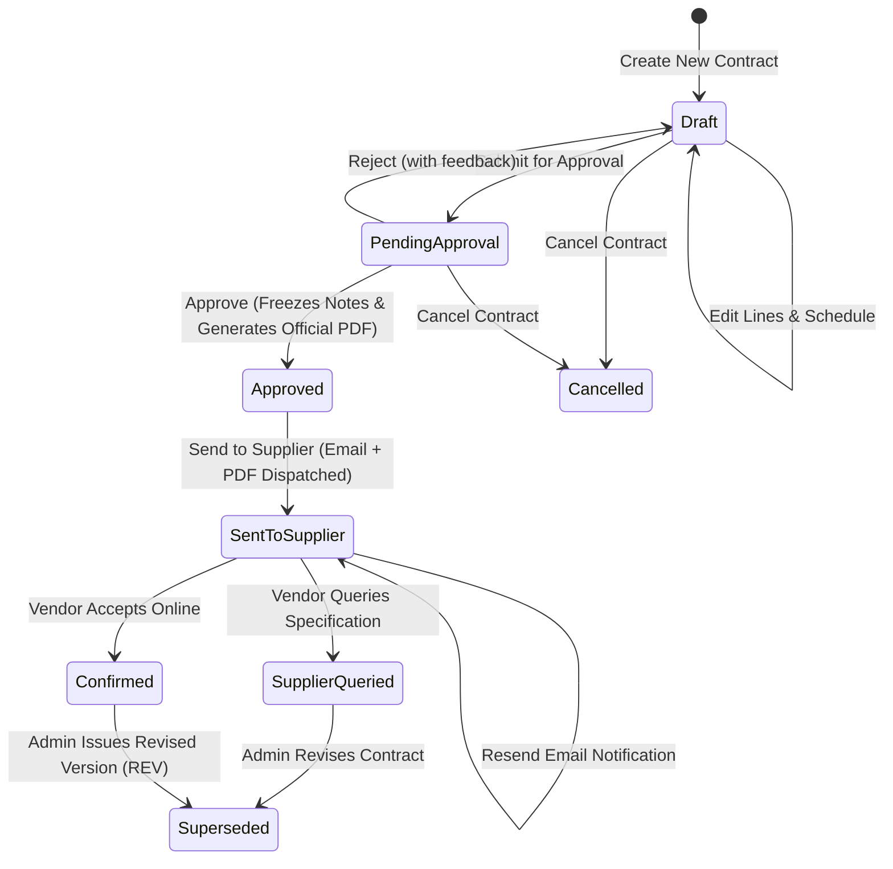

# Preliminary Contract (PC) Module — Administrator & Buyer Operating Guidebook
**PT Mega Perintis Tbk — Fabric Sourcing & Procurement Operations**  
*Document Version: 2.0 (APAC Enterprise Standard) | System: Vendor Portal (PC Module)*

---

## 1. Executive Overview & Purpose

A **Preliminary Contract (PC)** is the official commercial instrument used by **PT Mega Perintis Tbk** to lock in fabric mill manufacturing capacity, greige yarn booking, and production timelines with domestic and international fabric suppliers prior to issuing finalized Purchase Orders (POs).

### Core Objectives:
1. **Capacity & Yarn Reservation**: Enables mills to procure raw yarn and reserve weaving/knitting loom capacity without waiting for finished garment cutting schedules.
2. **Technical Alignment**: Locks in construction, weight (GSM), cuttable width, shrinkage tolerances, and HS Codes upfront to prevent customs and production bottlenecks.
3. **Delivery Milestone Commitment**: Establishes strict fabric readiness and FOB/CIF delivery windows.
4. **Binding Standard Clauses**: Enforces PT Mega Perintis standard terms, including mandatory SGS/third-party inspections, internal fabric test reports, and shadeband submissions prior to shipment.

---

## 2. User Roles & Permission Matrix

| Role | Permissions | Responsibilities |
| :--- | :--- | :--- |
| **Preparer / Merchandiser** | Create, Edit, Submit, Revise | Prepares contract header, searches items, specifies delivery schedules, and submits for approval. |
| **Approver** | Approve, Reject | Reviews commercial terms, tolerance values, pricing, and approves using two-factor authorization. |
| **Fabric Admin** | Full Admin Privileges, Master Data, Resend Email | Manages lookup catalogs (HS Codes, Lots, Terms), triggers ERP synchronization, resends vendor notifications. |
| **Fabric Vendor** | View, Accept, Query, Download PDF | Accesses portal, reviews technical terms, confirms booking or queries specifications. |

---

## 3. Preliminary Contract Lifecycle & State Machine

---

## 4. Step-by-Step Operating Procedures for Buyers / Admins

### Step 1: Creating a New Preliminary Contract
1. Navigate to **Preliminary Contract** &rarr; **Contracts** &rarr; Click **"+ New Contract"**.
2. **Supplier / Vendor**: Select the authorized fabric mill from the searchable dropdown. The system automatically populates the vendor's default currency and payment terms.
3. **Contract Header Details**:
   - **Contract Date**: Defaults to current date.
   - **Season**: Select the merchandising season (e.g. `FALL'26`, `FESTIVE'26`).
   - **Fabric Type**: Select category (Woven, Knitted, Denims, Jacquards, etc.).
   - **Currency**: USD, CNY, EUR, or IDR.
   - **Payment Terms**: Commercial terms as agreed (e.g., *LC 60 Days*, *TT 30 Days*, *CBD*).
   - **Terms of Delivery (Incoterm)**: FOB, CIF, CNF, Ex-Factory, etc.
   - **Mode of Transport**: Sea Freight, Air Freight, Courier, Land Transport.
   - **VAT / PPN Treatment**: Select standard tax treatment (e.g. Non-VAT Import, PPN 11%).

### Step 2: Line Items & Fabric Technical Specifications
For each fabric line item:
- **Search Item Code / PLM Ref**: Use the real-time search box to search ERP/PLM items, or type the custom mill item code.
- **HS Code**: Select or search the 8-digit international tariff code (e.g. `5407.69.90`).
- **Lot Number**: Specify the lot identification (e.g. `1-2`, `3-4`).
- **Color / Batch Name**: Specify color reference or mill lab dip code.
- **Cuttable Width**: Enter minimum usable width (e.g., `57/58"`).
- **Weight**: Enter finished fabric density (e.g., `180 GSM`, `120 G/M2`).
- **Quantity & UOM**: Input volume (Yards, Meters, Kilograms).
- **Unit Price**: Input FOB/CIF agreed unit price.
- **Shipment Tolerance**: Default tolerance limits (`-5.00%` underdelivery, `+5.00%` overdelivery).

### Step 3: Fabric Delivery Schedule Milestones
Contracts support single or multiple staggered delivery splits per line item:
- Click **"+ Add Delivery Split"** to create milestone rows.
- Specify **Target Delivery Date** and **Quantity Breakdown**.
- The interface automatically validates that scheduled deliveries match or reconcile with total contracted line volume.

### Step 4: Standard Clauses & Additional Notes
PT Mega Perintis preloads standard textile booking clauses (Clauses 1–9) with critical requirements highlighted:
- **Clause 1**: Yarn booking reservation notice (Strict prohibition on bulk dyeing without confirmed PO).
- **Clause 2**: Bulk fabric production strictly against color breakdown and confirmed Purchase Order.
- **Clause 3**: Pre-shipment documentation mandatory checklist (Internal Test Report, Shadeband/Shadelot, 100% Inspection Report).
- **Clause 4**: Mandatory SGS/third-party factory inspection for imported goods.
- **Clause 7, 8, 9**: Quality guarantees, late delivery liquidated damages, and cancellation terms.
- **Custom Clauses (10+)**: Click **"+ Add Clause"** to append factory-specific specifications (e.g., OEKO-TEX certification, GOTS compliance, laboratory testing thresholds).

### Step 5: Submitting for Approval
- Click **"Save Draft"** at any time to preserve progress.
- Once complete, click **"Submit for Approval"**. The system executes strict validation checks (`PcContractValidator`).
- The contract transitions to `Awaiting Approval` and notifies the designated approvers.

### Step 6: Approval & PDF Generation
- An authorized Approver (listed in Approver Pool) reviews the contract.
- Approver clicks **"Approve"**.
- The system:
  1. Freezes notes, tolerances, and header snapshots into historical audit tables (`pc_contract_notes`, `pc_contract_tolerances`).
  2. Generates the tamper-evident **Official Contract PDF** with digital signature stamps and stores it securely on AWS storage.
  3. Transitions status to `Approved`.

### Step 7: Sending to Supplier (Vendor Portal Dispatch)
- On the approved contract view, click **"Send to Supplier"**.
- The system verifies:
  - Stored official PDF is present (`PC-A01`).
  - Vendor has at least one active Vendor Portal account (`PC-A02`).
- The system automatically sends an **APAC Enterprise Standard Email Notification** with the official PDF contract attached directly to the vendor's primary and notification email addresses.
- Status updates to `With Vendor (Sent to Supplier)`.

### Step 8: Resending Email to Supplier
- If a vendor requests a re-transmission or new contacts are added:
  - Open the contract in `Sent to Supplier` status.
  - Click the **"Resend Email"** button on the top toolbar.
  - The system dispatches the email notification and PDF attachment with full audit logging.

### Step 9: Revisions (Revise Contract)
- If commercial terms change after approval:
  - Open the contract and click **"Revise"**.
  - Enter the revision justification (e.g. *Price renegotiation based on raw cotton indices*).
  - The system creates a new revision with an incremented revision number and updates the reference code (e.g., `MPG/PC/PDV/26/X/451 (REV)`).
  - The previous version is safely marked as `Superseded`.

---

## 5. Master Data & System Settings Administration

Access via **Preliminary Contract** &rarr; **Master Data & Settings**:
1. **HS Codes**: Manage approved 8-digit Harmonized System customs codes with standard descriptions.
2. **Lots**: Manage standard factory batch codes.
3. **Transport Modes**: Configure Sea Freight, Air Freight, and Land Logistics identifiers.
4. **Terms of Delivery (Incoterms)**: Manage international commercial terms (FOB, CIF, CFR, EXW).
5. **Seasons**: Open or close procurement seasons to control active booking windows.
6. **Approver Settings**: Manage the comma-separated pool of authorized approver email addresses.

---

## 6. Audit Trail & ERP Synchronization

- **Audit Log**: Every creation, submission, approval, rejection, supplier dispatch, vendor acceptance, query, and revision is permanently recorded in `pc_audit_logs`.
- **D365 ERP Sync**: Tracks real-time sync feeds for fabric vendors, payment terms, and PO linkages.
